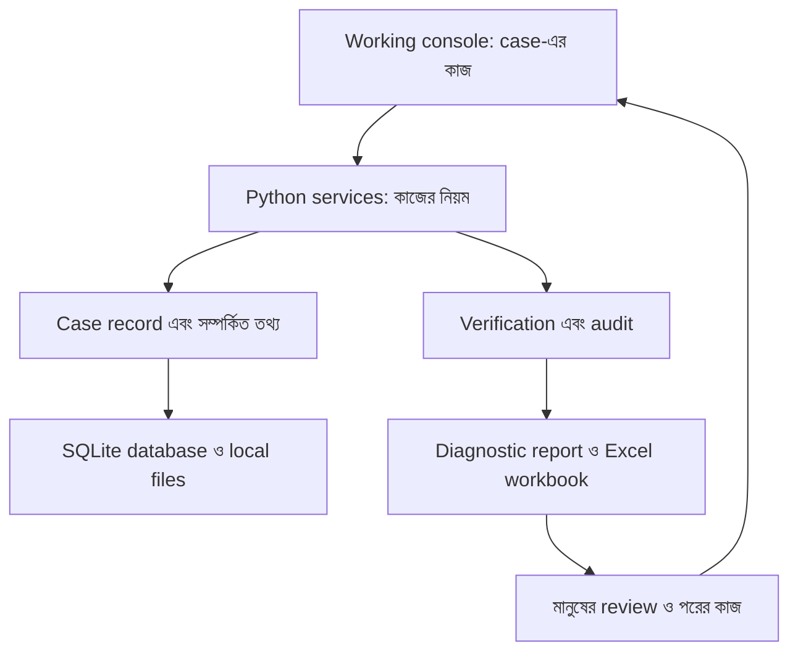

# TenderOS: একটি tender-এর কাজ, একটি সংযুক্ত case record

পাঠকের জন্য ব্যাখ্যা · ২২ অক্টোবর ২০২৬ · Source code ও সংরক্ষিত release evidence-এর ভিত্তিতে।

ধরুন, একটি consulting firm একটি tender পেল। ToR-এ লেখা আছে কী কাজ করতে হবে, কারা অংশ নিতে পারবে, কোন অভিজ্ঞতা লাগবে এবং কী জমা দিতে হবে। প্রতিষ্ঠানটির কাছে CV, আগের কাজের records ও supporting documents-ও আছে। কিন্তু এগুলো আলাদা folder, spreadsheet ও মানুষের স্মৃতিতে ছড়িয়ে থাকলে একটি সহজ প্রশ্নের উত্তর কঠিন হয়ে যায়: **আমরা কি এই tender-এর জন্য প্রস্তুত, এবং সেই দাবির পক্ষে প্রমাণ কোথায়?**

ProposalGuard / TenderProof OS—এই আলোচনায় TenderOS—এই কাজ গুছিয়ে করার জন্য তৈরি একটি local application। এর মূল উদ্দেশ্য donor tender ও proposal-এর diagnostic service চালানো: প্রয়োজন বোঝা, evidence মেলানো, ঘাটতি চিহ্নিত করা, সিদ্ধান্ত নেওয়া এবং reviewযোগ্য report তৈরি করা।

একটি tender এখানে একটি **Case**। Case-এ client, tender title, donor, country, sector ও deadline-এর মতো পরিচয় থাকে। সেই case-এর সঙ্গে source document, requirement, compliance row, CV evidence, risk, decision ও output যুক্ত হয়। একে “one operational record” বলা যায়। তবে এর মানে সব তথ্য database-এর একটি row-তে রাখা নয়। একাধিক সম্পর্কিত record একই `case_id` দিয়ে একটি tender-এর সম্পূর্ণ কাজকে ধরে রাখে।

একটি হাসপাতালের patient file-এর সঙ্গে তুলনা করা যায়। Report, prescription ও test আলাদা হলেও কোন রোগীর জন্য সেগুলো—তা পরিষ্কার থাকে। TenderOS-এও source document ও decision আলাদা বস্তু, কিন্তু একই case-এর সঙ্গে তাদের সম্পর্ক থাকে। এই সম্পর্কই architecture-এর কেন্দ্র।

Diagramটি logical flow দেখায়; আলাদা cloud service বা public API বোঝায় না।

কাজটি সাধারণত একটি ToR upload বা pasted source text দিয়ে শুরু হয়। Text extraction source-কে পড়ার উপযোগী করে। Scanned PDF হলে optional local OCR লাগতে পারে; তার লেখা মূল document দেখে যাচাই করতে হয়। তারপর বড় clause ভেঙে ছোট, নির্দিষ্ট requirement তৈরি করা হয়। যেমন, “Team Leader-এর postgraduate degree ও দশ বছরের অভিজ্ঞতা থাকতে হবে”—এই কথার মধ্যে qualification ও experience-এর আলাদা দাবি আছে। ছোট requirement করলে প্রতিটির evidence আলাদা করে দেখা যায়।

এরপর Compliance Matrix কাজ শুরু করে। প্রতিটি requirement-এর বিপরীতে কী evidence দরকার, কী পাওয়া গেছে, কোথায় gap, কে কাজ করবেন এবং action কী—সেগুলো রাখা যায়। CV Matcher একইভাবে expert-এর দাবি supplied evidence-এর সঙ্গে মেলাতে সাহায্য করে। Stable keys ও source anchors requirement চিনতে সহায়তা করে। পূর্ণ visual evidence inspector এখনও উন্নয়নের বিষয়; একটি anchor থাকলেই প্রতিটি সিদ্ধান্তের সম্পূর্ণ provenance নিশ্চিত হয়ে যায় না।

আপনি যে চারটি অংশের কথা বলেছেন, সেগুলো এই case-কে ঘিরেই বোঝা সহজ। **Working console** হলো দৈনন্দিন কাজের ডেস্ক। বর্তমান app-এর ১৬টি page—Command Center, source intake, extraction, compliance, CV matching, scorecard, risks, methodology, reports, exports, verification এবং অন্যান্য সহায়ক page—একই case-এর কাজ দেখায়। Workflow Optimizer কোন ধাপ হয়েছে এবং পরের কাজ কোথায়, তা নির্দেশ করে। Page বদলালেও tender-এর পরিচয় বদলায় না।

**Scenario simulation** হলো সিদ্ধান্তের আগে বিকল্প পরীক্ষা করার ধারণা। ধরুন, একা bid করলে expert evidence দুর্বল, কিন্তু partner নিলে প্রয়োজনীয় অভিজ্ঞতা পাওয়া যেতে পারে। ভবিষ্যতের scenario workbench-এ মূল case অক্ষত রেখে “একা”, “partner”, “sub-consultant” বা “no-bid” বিকল্প আলাদা assumptions দিয়ে তুলনা করা যাবে। বর্তমান app-এ bid/no-bid scorecard ও recommendation আছে; saved alternatives, sandbox, scenario comparison এবং reproducible scenario replay এখনও roadmap। Score বদলে নতুন recommendation দেখা আর সম্পূর্ণ scenario engine থাকা এক বিষয় নয়।

**Monitoring and response** মানে কাজের অবস্থার ওপর নজর রাখা এবং তার পরের করণীয় নির্ধারণ করা। বর্তমান Gap Items, Risk Register, compliance actions ও workflow guidance দিয়ে কোথায় তথ্য বাকি, ঝুঁকি কী এবং কী করতে হবে—তা রাখা যায়। Audit log-এ কিছু কাজের history থাকে। কিন্তু background deadline alerts, automatic official-portal amendment monitoring, portfolio-wide escalation বা external notification system implemented ধরে নেওয়া যাবে না। এসব concept map-এর উন্নয়নের দিকনির্দেশ।

**Infrastructure** হলো এই কাজ ধরে রাখার ভিত্তি। Streamlit screen তৈরি করে; Python services extraction, normalization, scoring, verification ও export-এর নিয়ম চালায়; SQLAlchemy database-এর সঙ্গে কাজ করে; SQLite case records রাখে। Uploaded documents, extracted text, reports ও workbooks local folders-এ থাকে। Templates, reference notes এবং reusable IP capture পুনরায় ব্যবহারযোগ্য knowledge রাখতে সাহায্য করে। বর্তমান scope-এ connected external AI provider, public SaaS authentication, billing কিংবা automatic e-GP submission নেই।

ধরুন, একটি requirement-এর জন্য একটি licence দরকার। প্রথমে requirement register করা হলো। Compliance row-তে licence-এর evidence লেখা হলো। Evidence না থাকলে Gap/Pending Input হিসেবে কাজ তৈরি হবে। Evidence পাওয়া গেলে মানুষকে দেখতে হবে licence আসলেই এই bidder-এর, প্রযোজ্য সময়ে বৈধ এবং নির্দিষ্ট clause-এর জন্য যথেষ্ট কি না। Report-এর ভাষা তখন এই evidence-এর অবস্থার সঙ্গে সামঞ্জস্যপূর্ণ হওয়া দরকার। এভাবেই source থেকে requirement, evidence, decision ও output পর্যন্ত কাজের সম্পর্ক গড়ে ওঠে।

এখানে **commercial attractiveness** এবং **permission to release** আলাদা প্রশ্ন। কোনো tender খুব লাভজনক হতে পারে, কিন্তু mandatory eligibility পূরণ না হলে আকর্ষণীয় score দিয়ে সেই বাধা মুছে ফেলা যায় না। মূল app-এর scorecard মূল্যায়ন ও recommendation দেয়। Isolated Release 012 candidate-এ আরও কঠোর controls তৈরি করা হয়েছে: source/evidence freshness, validity, review, snapshot-bound approval, approval invalidation এবং governed output। মূল app-এর সঙ্গে candidate-এর এই পার্থক্য মনে রাখা জরুরি।

Release 012 candidate-এর ধারণাটি সহজ: reviewer একটি নির্দিষ্ট সময়ের evidence ও verification দেখে approval দেবেন। পরে relevant source, requirement বা evidence বদলালে পুরোনো approval দিয়ে নতুন অবস্থাকে অনুমোদিত দেখানো যাবে না। Candidate-এর versioned reports ও workbooks-ও সেই current state-এর সঙ্গে সম্পর্ক রাখে। এটি একটি নির্দিষ্ট case-এর approval; software release approve করার সিদ্ধান্ত আবার আলাদা। Named local reviewer entry-কে authenticated multi-user identity system হিসেবেও ধরা যাবে না।

Project-এর maturity বুঝতে repository-এর তিন ধরনের কাজ আলাদা করে পড়তে হবে। `tenderproof_os/` হলো preserved original operational application। `release_012_safety/` এবং `release_012_controlled_2026-10-15/` হলো isolated safety work ও তার review/evidence। `docs/`-এর concept map ভবিষ্যতের product direction ব্যাখ্যা করে। এগুলো একই repository-তে থাকলেও সব code মূল application-এ integrated হয়ে গেছে—এমন নয়।

Release history-তে একটি পুরোনো STOP_REPORT আছে। পরে resumption এবং verification-এর records-ও আছে। Controlled candidate-এর `evidence/test_summary.json`-এ **121 regression checks** এবং আলাদা **24 safety checks** pass হিসেবে সংরক্ষিত আছে। এগুলো আগের execution-এর records; এই architecture documentation লেখার সময় tests আবার চালানো হয়নি। পরের records দেখায় যে পুরোনো stop-কে পুরো project-এর চূড়ান্ত status হিসেবে পড়া ঠিক হবে না।

একই সঙ্গে operator runbook ও final boundary record-এ **operational integration/merge approval pending** আছে। তাই বর্তমান সঠিক অবস্থান হলো: local diagnostic workflow-এর original app আছে, safety controls-এর verified candidate আছে, এবং broader scenario/monitoring product-এর roadmap আছে। Publicly deployed final product বা integrated Release 012 operational installation-এর দাবি এই records সমর্থন করে না। GitHub-এ commit/push project সংরক্ষণ করে; সেটি app install, database migration বা release approval সম্পন্ন করে না।

ব্যবহারকারীর দিক থেকে final usability-এর আসল প্রমাণ হবে একটি বাস্তব case নিরাপদে চালাতে পারা: authoritative input নেওয়া, requirements মানুষের review করা, evidence ও gaps দেখা, সঠিক decision state পাওয়া, current approval অনুযায়ী report/export করা এবং প্রয়োজনে recovery করা। এই অভিজ্ঞতার ভিত্তি ইতিমধ্যে তৈরি হয়েছে। Saved scenarios, automatic monitoring ও আরও সম্পূর্ণ traceability সেই ভিত্তির ওপর পরবর্তী কাজ।

## যাচাই করা source locations

- Original scope ও limits: [`tenderproof_os/README.md`](../tenderproof_os/README.md)
- Console/page assembly: [`app.py`](../tenderproof_os/app.py)
- Case ও related entities: [`models.py`](../tenderproof_os/tenderproof/models.py)
- Storage ও database: [`config.py`](../tenderproof_os/tenderproof/config.py), [`db.py`](../tenderproof_os/tenderproof/db.py)
- Original workflow, scoring ও verification: [`workflow_service.py`](../tenderproof_os/tenderproof/services/workflow_service.py), [`bid_score_service.py`](../tenderproof_os/tenderproof/services/bid_score_service.py), [`verification_service.py`](../tenderproof_os/tenderproof/services/verification_service.py)
- Controlled candidate workflow/limits: [`OPERATOR_REVIEW_RUNBOOK.md`](../release_012_controlled_2026-10-15/OPERATOR_REVIEW_RUNBOOK.md)
- Historical test results: [`test_summary.json`](../release_012_controlled_2026-10-15/evidence/test_summary.json)
- Preservation ও pending approval: [`final_boundary.json`](../release_012_controlled_2026-10-15/evidence/final_boundary.json), [`RECOVERY_AND_INTEGRATION_REVIEW.md`](../release_012_controlled_2026-10-15/RECOVERY_AND_INTEGRATION_REVIEW.md)
- Product roadmap/design artifact: [`create_concept_map.py`](../create_concept_map.py), [`concept map PDF`](concept-map-tenderly-to-tenderos.pdf)
