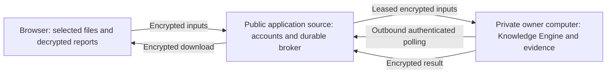

# TenderOS v1.4 development implementation

Date: 23 October 2026 (Asia/Dhaka). Mode: **PILOT_PC**. Public and paid production release: **BLOCKED**.

The owner's request authorizes building the supplied direction and publishing the public application source. It explicitly reserves the Knowledge Engine to the owner's local computer. Draft documents are requirements inputs; their pending decisions, signature fields and historical evidence have not been converted into approvals.

## Working boundaries

`apps/web/` contains the Next.js public application and API. `packages/contracts/` contains public transport contracts only. The new proprietary engine source, local model policy, keys, plaintext source files, provenance store and generated artifacts are outside this repository under `%USERPROFILE%\TenderOS-Private\private-engine`. This stable owner folder is outside OneDrive and application caches. Private source has a local Git history with no remote. It is not part of GitHub, frontend bundles, or a hosted worker.

The public broker stores minimized account/case metadata, ciphertext and sanitized job state. Case titles, bidder/issuer identifiers and operational request notes are metadata, not encrypted file content; the interface identifies this distinction. Encryption does not protect plaintext from a compromised browser or owner computer.

The existing `tenderproof_os/` operational app and separate Release 012 candidates are preserved. Their databases have not been migrated or integrated into this new application.

## Delivered development capabilities

| Area | Implemented development behavior | Remaining acceptance work |
|---|---|---|
| Identity | Local customer registration, scrypt password hashes, expiring HttpOnly sessions, logout, server-side ownership/assignment checks | Hosted identity, MFA, email verification/reset, private cross-operator source delegation and independent access-control assessment |
| Cases | Persisted account-scoped operational case, service selection, source version and timeline | Domain acceptance and real customer pilot |
| Inputs | Browser encryption, single-use upload slots, immutable ciphertext checksums, explicit source category, private-node parsing | Approved crypto profile/trust distribution, malware sandbox and production object-store integration |
| Processing | Durable SQLite job queue, idempotency identity, frozen input snapshots, leases/heartbeats, bounded attempts, cancellation and encrypted completion | Fault/security suites, load targets, production datastore and recovery drills |
| A compliance | Source-linked candidate requirements, evidence suggestions, gap review, named local review and preliminary artifacts via private node | Approved complete extraction/assurance policies and procurement gold corpus; no formal positive clearance |
| B CV fit | Private candidate processing with separate consent, source/criteria linkage and draft chronology ledger | Approved duration/equivalence/ranking policy and representative gold set |
| C managed CV | Request and accepted work order; authorized internal source-backed drafting scaffold | Confirmed candidate facts, professional editing and separate qualified final approver |
| D managed proposal | Work orders, internal technical drafting scaffold and explicit Decimal financial calculations | Full professional methodology/workplan, approved tax/currency rules, cross-artifact and final release checks |
| Research | Internal stored-file evidence workspace, persistent source/claim traces; external retrieval off | Complete governing research constitution, approved retrieval permissions and citation/research acceptance |
| Reports | Encrypted HTML, DOCX and XLSX draft artifacts returned to the initiating browser profile | Final format/domain acceptance, PDF delivery and approved current-snapshot release |
| Operations | Node heartbeat, queue status, case audit events, readiness gates, consultation/deletion request recording | Actual deletion/retention execution, incident operations, dedicated server, restore and signed rollback |
| Payments | Checkout fails closed; notifications cannot create entitlement; local processing is free development | Merchant contract, prices/refunds, authenticated settlement integration and sandbox acceptance |

The owner workstation also supports an optional installed local model through its private configuration. Cloud/remote model tags and external fallback are disallowed. Model suggestions remain source-checked candidates; model availability is not a quality benchmark. No private model selection, prompts or engine implementation are shipped in the public package.

## Phase disposition

| Gate | Current disposition |
|---|---|
| P0 / G0 | Source baseline pinned and archived locally; source reuse and public/private contracts recorded. Policy owners, inherited decisions, approved golden cases and cryptographic sign-off remain pending. |
| P1A / G1A | Development vertical slice implemented; domain/model acceptance remains pending. |
| P1B / G1B | Local encrypted integration and durable broker implemented; independent security, payment and recovery evidence remain pending. |
| P2 / G2 | Controlled real-domain Service A pilot not performed. |
| P5S / GS | Dedicated owner server, replacement-machine recovery and signed rollback not performed. |
| GA-L / GB-L | Paid launches blocked. |
| G4 / G4R / G5 | Managed professional delivery and research release acceptance pending. |

Numerical model/OCR/latency thresholds, a named maintainer/recovery custodian, cryptographic review, CV/finance policy, service prices and qualified reviewer authority require actual owner/domain/security decisions. The full referenced DeepResearch constitution and inherited earlier decision definitions were not supplied as complete standalone source documents; exact conformance is not claimed.

## Preservation and recovery

Baseline Git commit: `b4d1b1df402b31face556fb903f5ecd22b5601d0`. A source archive and Git object inventory are saved outside Git by `tools/freeze-baseline.mjs`. This is source recoverability evidence, not an executed recovery of customer databases or production infrastructure.

Rollback the development application by stopping its own web/node processes. The original application remains separately available; no reverse migration is required. Preserve the external private engine and runtime before removing the new public checkout. Browser profile keys are needed for prior encrypted results; this edition does not provide cross-device key recovery.

Source files and commands are sealed to their initiating user/browser profile, recipient, action and source manifest. A different browser or assigned staff user cannot process existing sources without a future private delegation mechanism. This edition does not claim a complete multi-operator confidential handoff or independently authenticated production signing design.

## Public implementation decisions

- Use Next.js App Router and server-side Node APIs for the new public plane; preserve original Python/Streamlit separately.
- Use a local transactional SQLite adapter for the owner workstation. Do not describe Atlas, R2, Vercel, Render or Paystation as configured deployments.
- Keep heavy parsing, rules, model routing and document production in the external private node. No inbound general-purpose engine endpoint.
- Make all new service results preliminary and fail closed on final release until approved domain/assurance/reviewer policies exist.
- Leave legacy ten-category scoring intact in the original app; no unapproved four-domain crosswalk replaces it in this development platform.
- Keep source design documents and extracted specifications local. Public documentation describes only product behavior and transport boundaries.

Implementation references: [public integration contract](../packages/contracts/README.md), [local startup](../README.md). Framework/protocol references consulted: [Next.js installation](https://nextjs.org/docs/app/getting-started/installation), [Node SQLite](https://nodejs.org/docs/latest-v24.x/api/sqlite.html), [Web Crypto encryption](https://developer.mozilla.org/en-US/docs/Web/API/SubtleCrypto/encrypt), [Ollama structured outputs](https://docs.ollama.com/capabilities/structured-outputs) and [local-only mode](https://docs.ollama.com/faq#how-do-i-disable-ollamas-cloud-features).

## Observed implementation evidence

- The Next.js production build completed successfully with TypeScript checking. PowerShell launcher syntax parsed successfully. No application unit, regression, security or benchmark suite was added or run for this request.
- A fictional case was created in the real browser interface, two example documents were encrypted/uploaded, and the persisted broker job was consumed by the external private worker. The initiating browser authenticated the result receipt and decrypted the returned preliminary report bundle.
- The refined fictional run displayed seven source-linked candidates, eight review gaps, `UNKNOWN` mandatory clearance and `HOLD` recommendation. HTML, DOCX and XLSX draft artifacts were present in the authenticated decrypted bundle. This single development walkthrough is not procurement acceptance, a model benchmark, an OCR assessment or a production security audit.
- Repository diffs showed no changes to the preserved original application or Release 012 trees. The public index is checked for private/runtime files and credential patterns before commit. New private source has separate local commits and no Git remote.
- All eight supplied owner files were also preserved with checksum manifests inside the private runtime. Their originals remain in their supplied locations. The OCR text remains an unverified background reference; it has not been promoted into case authority or an approved rule pack.
